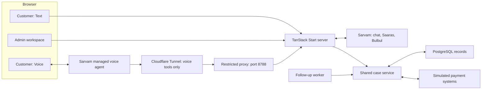
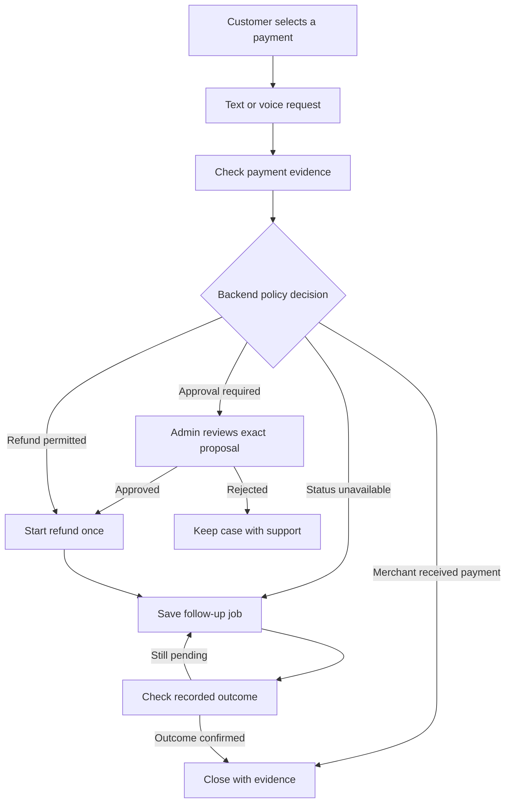

# Sahay AI

## Description

Sahay AI is a payment support prototype for TeamApex. Customers can use text or voice to check a payment and request an investigation. Support staff can review cases, approve refund proposals, and see recorded results.

Text and voice use the same case rules and records. Sarvam provides the language and speech services.

**Demo scope:** Payment data, policies, refunds, and bank actions are simulated. Sarvam API calls are live when valid keys are configured. The app does not connect to live Paytm payment systems.

## Features

- Separate customer and admin workspaces.
- Saved chats, payment evidence, and case history.
- Text support in the customer's language.
- A separate Voice tab with Aparna, call status, duration, and mute controls.
- Approval checks and duplicate refund prevention.
- Recovery after a lost payment service response.
- Saved follow-up jobs and recorded case results.

## Architecture



| Area | Technology |
| --- | --- |
| Application | TypeScript, TanStack Start, Vite, React |
| Routing and data | TanStack Router and Query |
| Text chat | TanStack AI client and AG-UI event stream |
| UI controls | Official shadcn controls, preset `b1YnRHXDE` |
| AI and speech | Sarvam-105B, Saaras v4, Bulbul `bulbul:v4-flash` |
| Voice calls | Sarvam managed voice agents and browser SDK |
| Database | Local PGlite or external PostgreSQL |

Provider keys stay on the server. Python and Docker are not required for local use.

## Setup

### Requirements

- Node.js 22.12 or later.
- pnpm 12.4.1, as set in `package.json`.
- A Sarvam API key for live AI services.
- `cloudflared` for local managed voice tool calls.

### Install and start

From the repository root, install the packages:

```sh
pnpm install
```

For a new checkout, create the environment file. Keep an existing `.env` file:

```sh
test -f .env || cp .env.example .env
```

Set the required values in `.env`, then start the app:

```sh
pnpm dev
```

Open these views in separate browser windows:

- [Customer support](http://127.0.0.1:3000/customer/chats)
- [Admin workspace](http://127.0.0.1:3000/admin/cases)
- [Admin results](http://127.0.0.1:3000/admin/results)

Customer and admin sessions are separate. Both views can use the same browser. The local demo admin code is `sahay-finals` unless `TEAM_ACCESS_CODE` is changed.

### Environment variables

| Variable | Use |
| --- | --- |
| `SARVAM_API_KEY` | Chat, speech input, and speech output. |
| `CHAT_MODE` | Set to `live` for Sarvam chat or `simulation` for offline text responses. |
| `DATABASE_URL` | External PostgreSQL connection. Leave empty to use local PGlite. |
| `TEAM_ACCESS_CODE` | Admin workspace access code. Change it before deployment. |
| `SARVAM_VOICE_API_KEY` | Voice Agents platform API key. |
| `SARVAM_VOICE_ORG_ID` | Voice organisation ID. |
| `SARVAM_VOICE_WORKSPACE_ID` | Voice workspace ID. |
| `SARVAM_VOICE_APP_ID` | Managed agent ID. |
| `VOICE_TOOL_SECRET` | Shared Bearer secret for calls from Sarvam to the case tools. |

Keep keys and secrets in `.env`. Do not commit this file. The voice platform key and `VOICE_TOOL_SECRET` have different uses.

### Database

Without `DATABASE_URL`, the app saves records in `apps/web/.data/postgres`. Records remain after the app restarts. Use only one app server with this local database.

With `DATABASE_URL`, the app uses external PostgreSQL. The prototype stores case state in one JSONB row and locks it during changes. Use separate tables before scaling the system.

## Managed voice setup

1. Set the `SARVAM_VOICE_*` values and `VOICE_TOOL_SECRET` in `.env`.
2. In Sarvam, create a string call-start variable named `case_reference_number`. The app supplies the selected case UUID.
3. Configure both tools below. Use `POST`, `Content-Type: application/json`, and Bearer authentication with `VOICE_TOOL_SECRET`.
4. Map `case_reference_number` to the body field `caseId` with the variable picker.
5. In each response template, insert the returned `spokenSummary` field. A generic success message does not give the agent payment facts.
6. Enable both tools and commit the agent version.

| Tool | Endpoint |
| --- | --- |
| `get_case_context` | `/api/voice-tools/context` |
| `investigate_case` | `/api/voice-tools/investigate` |

Both tools accept this body:

```json
{
  "caseId": "<selected case UUID>"
}
```

Each new call uses the latest committed agent version. Commit draft edits, end the current call, and start a new call to use the changes.

The Voice tab does not add voice transcripts to chat. Voice tools cannot approve a refund. The agent must use the backend result for payment facts and action status.

### Local tunnel

Sarvam needs a public HTTPS address for tool calls. Route a named Cloudflare Tunnel to `http://127.0.0.1:8788`. Keep the app running and start the restricted proxy in another terminal:

```sh
pnpm tunnel:proxy
```

The installed named tunnel service provides the public connection. For a temporary tunnel instead, run:

```sh
pnpm tunnel
```

The temporary URL changes after restart. Use the current public hostname in both Sarvam tool URLs. Keep the app, proxy, and tunnel running during the demo.

The proxy exposes only the two voice tool routes. Other routes return `404`. Do not route the full app on port 3000 through this tool tunnel.

See [voice tool and tunnel setup](docs/VOICE-TUNNEL.md) for details.

### Other speech controls

Without a managed voice workspace, **Record voice** captures up to 25 seconds and sends the audio to Saaras v4. Review the transcript before you send it.

Use **Listen** to play a saved response through Bulbul v4 Flash. The managed workspace has its own voice settings; check which model and speaker it supports.

## Demo cases

| Payment | Expected result |
| --- | --- |
| ₹650 · Apex Mobile | Recover a refund after the payment service loses its response. Do not create a second refund. |
| ₹1,200 · Apex Groceries | Confirm merchant credit. Do not issue a refund. |
| ₹4,800 · Apex Electronics | Request admin approval before a refund starts. |
| ₹900 · Apex Cafe | Wait for the status service, then confirm merchant credit on a later check. |



### Run the demo

1. Select a payment in the customer view.
2. Use Text or Voice to request an investigation.
3. For the ₹4,800 case, open the admin inbox and approve or reject the exact proposal.
4. To run a saved follow-up now, select the case in admin and open **Demo controls → Advance simulation**. Or wait one minute with the app running.
5. Open **Admin → Results** to see counts from saved cases.
6. To repeat a case, use **Demo controls → Reset case**. Reset affects only the selected case and is blocked during an active text run.

Only admin can reset a case or advance demo time. A refund in progress is not a completed refund.

## Follow-up jobs

The local app checks saved jobs every five seconds. It processes missed jobs after restart.

With external PostgreSQL, you can run the separate worker:

```sh
pnpm worker
```

A hosted scheduler is not connected yet. Do not use the local timer as a serverless scheduler.

## Checks

```sh
pnpm test
pnpm build
```

The tests cover case rules, approval checks, duplicate actions, session access, saved records, voice payment facts, and call cleanup.

See [validation results and limits](docs/CORE-VALIDATION.md).

## Project files

| Path | Content |
| --- | --- |
| `apps/web/src/domain` | Shared case rules and simulated payment systems. |
| `apps/web/src/server` | API routes, database access, and Sarvam calls. |
| `apps/web/src/features` | Customer, admin, text, and voice screens. |
| `apps/web/src/components/ui` | Official shadcn controls. |
| `apps/web/tests` | Automated tests. |
| `apps/web/scripts` | Worker, tunnel proxy, and service checks. |
| `docs` | Setup details, validation, and deployment plan. |

## Current limits and deployment

- Payment systems and results are simulated.
- Admin access uses a demo code, not production identity management.
- The UI uses fixed shadcn screens. A general A2UI renderer is not included.
- External PostgreSQL and the Cloudflare application runtime are not verified yet.
- The public voice tool tunnel is not a full application deployment.

The proposed deployment uses Cloudflare Workers, Cloudflare Workflows, and Neon PostgreSQL. It needs database and scheduler changes before release. See the [deployment plan](docs/DEPLOYMENT.md).
